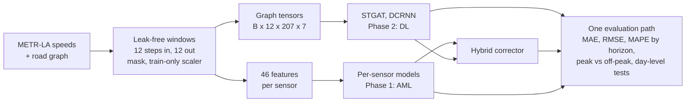
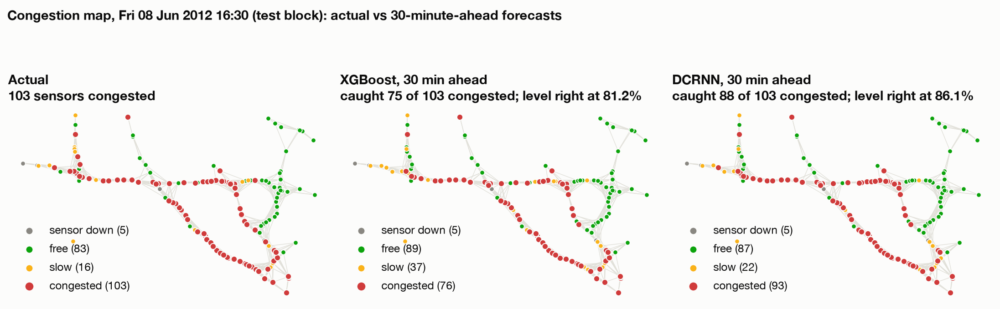
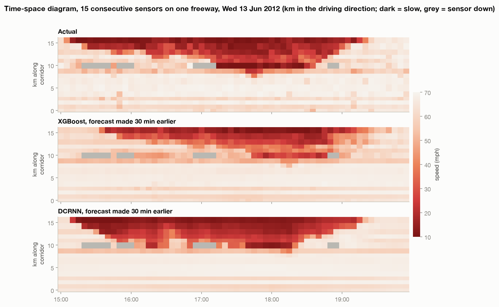

<div align="center">

# Traffic Flow Prediction and Signal Control via Graph Attention Networks and Flow Models

**Leak-free traffic speed forecasting on METR-LA: strong per-sensor baselines, a measured spatial gap,
graph neural networks that close it, and a hybrid that does best of all.**

[Live dashboard](https://trafficflowamldl.streamlit.app) ·
[DL report (PDF, 27 pages)](docs/dl_report/dl_report.pdf) ·
[DL slides (18)](docs/presentation/DL_Graph_Models.pptx) ·
[AML report (PDF, 22 pages)](docs/report/report.pdf) ·
[AML slides (13)](docs/presentation/AML_Traffic_Flow_Forecasting.pptx) ·
[Research paper, IEEE format (PDF)](docs/paper/paper.pdf)


</div>

---

## At a glance

**Question.** Does a model that sees the road network forecast traffic better than strong models that look at one
sensor at a time, and where does the gain come from?

We forecast freeway speed 5 to 60 minutes ahead for the 207 sensors of METR-LA (Los Angeles). Every model, from
persistence to graph neural networks, is trained and scored under one leak-free protocol and compared with
day-level significance tests.

| | 15 min | 30 min | 60 min |
|---|---|---|---|
| Best per-sensor model (XGBoost), test MAE in mph | 3.02 | 3.51 | 4.01 |
| DCRNN, diffusion graph model | 2.64 | 3.05 | 3.57 |
| **Hybrid: DCRNN + XGBoost residual corrector (ours)** | **2.62** | **3.01** | **3.47** |
| Hybrid's error reduction against XGBoost | 13.0% | 14.2% | 13.3% |

- **The graph helps, reliably.** DCRNN beats XGBoost by 12.3% / 13.1% / 11.0% at 15 / 30 / 60 minutes, on **all 24 test
  days** (paired day-level bootstrap and Diebold-Mariano tests, p < 0.0001).
- **The hybrid is the best model of the project**, with the lowest MAE and MAPE at every horizon and 16.5% lower
  weekday-peak error than XGBoost.
- **The gain comes from the real road graph.** Removing the graph or replacing it with a random one of the same size
  removes most of it, and listening to *downstream* neighbours matters most.
- **The attention is interpretable.** STGAT, our graph attention network, moves its attention downstream (52% to 62%)
  when a slowdown is 30 minutes away, for 149 of 163 sensors.
- **The implementation is faithful.** Our DCRNN port reproduces the published METR-LA numbers to within 1.5%.


*Congestion propagates backwards along the freeway at about 16 km/h: the downstream sensor slows first. A model that
sees only its own sensor's history cannot see this coming; a graph model can.*

> **Scope.** Signal control is simulation-only by design and was not run: METR-LA freeways have no traffic signals.
> Nothing in this project controls, or claims to control, real traffic.

## Contents

- [Project brief](#project-brief)
- [Data](#data)
- [Method](#method)
- [Phase 1 (AML): per-sensor baselines and the gap](#phase-1-aml-per-sensor-baselines-and-the-gap)
- [Phase 2 (DL): graph models and the hybrid](#phase-2-dl-graph-models-and-the-hybrid)
- [Congestion maps](#congestion-maps)
- [Outcomes](#outcomes)
- [Research foundation](#research-foundation)
- [Getting started](#getting-started)
- [Repository structure](#repository-structure)
- [Documentation](#documentation)
- [Testing and reproducibility](#testing-and-reproducibility)
- [Limitations](#limitations)
- [References](#references)
- [Team](#team)

## Project brief

*Project 4: Traffic Flow Control.* Predict congestion in a road network and test whether graph-based learning improves
on independent road-segment forecasts. The brief prescribes a hybrid logic:

1. **AML baseline:** segment-level features and XGBoost per segment or a multi-output Random Forest.
2. **Identify the gap:** independent segment models cannot represent how congestion propagates through upstream and
   downstream links.
3. **DL model:** a graph attention network or diffusion graph model over the road graph, with a fixed adjacency.
4. **Fair comparison:** chronological splits; MAE, RMSE and MAPE by forecast horizon; equal history windows; peak versus
   off-peak periods. Expected deliverable: a forecast comparison with congestion maps and horizon-wise metrics.

## Data

METR-LA ([Jagadish et al., 2014](https://doi.org/10.1145/2611567)) as distributed with the
[DCRNN](https://github.com/liyaguang/DCRNN#data-preparation) code: 34,272 five-minute speed readings from 207 loop
detectors, 1 March to 27 June 2012, with a directed road-distance adjacency matrix (1,515 links, mean degree 7.32).
8.1% of readings are sensor outages (0 mph), which are masked, never treated as traffic.

| Split | Windows | First target | Last target |
|---|---|---|---|
| Train (70%) | 22,933 | 2012-03-01 01:00 | 2012-05-23 07:05 |
| Validation (10%) | 3,417 | 2012-05-23 07:10 | 2012-06-04 04:45 |
| Test (20%, last 24 days) | 6,843 | 2012-06-04 04:50 | 2012-06-27 23:55 |

An [interactive map of the sensor graph](docs/figures/fig04_sensor_graph_map.html) is included (open it in a browser).

## Method



- **Leak-free protocol.** Timestamps are split 70/10/20 into train, validation and test; windows whose targets straddle a
  boundary are purged, so no target is in two splits. The scaler and imputation table are fitted on training data only,
  and a test proves that the reference window-level split lets train and validation targets overlap.
- **Outages are masked, not treated as zero traffic.** Missing readings are NaN targets with an explicit mask; every loss
  and metric ignores them.
- **Equal history for every model.** The last 12 steps (60 minutes) in, the next 12 steps (5 to 60 minutes) out.
- **One evaluation path.** Every model is scored by the same masked MAE, RMSE and MAPE functions in mph, on the same test
  windows. Peak = weekdays 07:00-09:59 and 16:00-19:59, judged on the predicted timestamp.
- **Hyper-parameters on validation only.** The test block is never used to choose anything.

## Phase 1 (AML): per-sensor baselines and the gap

Six baselines share one 46-column feature table (speed lags, rolling statistics, recent change, missing flags, cyclic
time, segment statistics). Test block, masked MAE in mph. Full tables: [results/baselines.csv](results/baselines.csv),
[results/gap_results.csv](results/gap_results.csv).

| Model | 15 min | 30 min | 60 min |
|---|---|---|---|
| Persistence | 3.49 | 4.20 | 5.37 |
| Historical average | 4.42 | 4.42 | 4.42 |
| Ridge per sensor | 3.31 | 4.08 | 5.17 |
| Random Forest (multi-output) | 3.08 | 3.68 | 4.45 |
| LSTM, no graph | 2.97 | 3.55 | 4.35 |
| **XGBoost per horizon** (best independent model) | 3.02 | 3.51 | 4.01 |
| XGBoost + neighbour speeds (both directions) | **2.91** | **3.42** | **3.95** |

**What the gap experiments show**
- XGBoost is the strongest independent model; its error grows steadily with the forecast horizon.
- In the 30 minutes after a congestion onset its error is 5.9 to 6.4 times larger than at other times (3,911 onsets in
  the test period).
- The errors of road-linked sensors are correlated (0.20 at 60 minutes for sensors one link apart) while those of
  unconnected sensors are not.
- Adding hand-made neighbour speeds lowers error at every horizon (up to 3.5%), so the missing information is spatial,
  but one-hop features capture only part of it. That is the case for a graph model.
- Weekday rush-hour error is 1.4 to 1.95 times off-peak error for every model.

**Model accuracy in plain terms.** Speed forecasting is a regression task, so there is no single accuracy figure. Two
plain-language scores on the test block ([results/accuracy.csv](results/accuracy.csv)): **percent accuracy** (100 minus
MAPE) and the share of forecasts **within 5 mph** of the true speed.

| Model | Percent accuracy (15 / 30 / 60 min) | Within 5 mph, % (15 / 30 / 60 min) |
|---|---|---|
| Persistence | 91.4 / 89.2 / 85.5 | 80.8 / 77.9 / 73.5 |
| Historical average | 86.1 / 86.1 / 86.1 | 76.5 / 76.5 / 76.5 |
| Ridge per sensor | 91.1 / 88.3 / 84.5 | 82.3 / 77.9 / 70.6 |
| Random Forest | 91.7 / 89.4 / 86.5 | 84.1 / 80.6 / 75.9 |
| LSTM (no graph) | 92.0 / 89.7 / 86.5 | 85.1 / 82.6 / 79.5 |
| **XGBoost (best independent model)** | 91.8 / 89.9 / 88.0 | 84.3 / 81.4 / 78.6 |
| **XGBoost + neighbours (both directions)** | 92.3 / 90.4 / 88.3 | 84.7 / 81.7 / 78.8 |

These percentages look high mainly because traffic flows freely most of the time, so the error in mph and the error
during congestion are the more informative quantities. See the AML report for RMSE, MAPE, peak versus off-peak and
validation scores.

## Phase 2 (DL): graph models and the hybrid

### Models

| Model | Idea | Parameters |
|---|---|---|
| **STGAT** (ours) | A shared GRU summarises each sensor's last hour; two GATv2 attention layers (4 heads) let each sensor attend to its road neighbours over **both directions of every link**, with edge features `[link weight, is_reverse]`; the head predicts the change from the last speed. Our attention layer is tested to equal PyTorch Geometric's `GATv2Conv`. | 65,420 |
| **DCRNN** (Li et al., 2018) | Diffusion convolution over forward and backward random walks (K = 2) inside a GRU encoder-decoder with scheduled sampling: the graph enters every recurrent step. A PyTorch port of the reference model. | 377,153 |
| **Hybrid** (ours) | DCRNN as the backbone plus one shallow, regularised XGBoost per horizon (depth 3, at least 200 samples per leaf, L2 = 10) that learns DCRNN's residual from time of day, recent change and both forecasts. Fitted on the validation block only, scored once on test. | DCRNN + 12 small tree models |

Training: masked MAE in mph, Adam, learning rate x0.1 at epochs 20 and 30, gradient clipping at 5, early stopping on
validation MAE (never before the last learning-rate drop), 3 seeds per model.

### Results

Same test block, windows, mask and metric code as the baselines. Graph models and the hybrid: mean of 3 seeds. Full
tables: [results/final.csv](results/final.csv), [results/significance.csv](results/significance.csv),
[results/ablations.csv](results/ablations.csv), [results/hybrid_ablation.csv](results/hybrid_ablation.csv).

| Model | MAE 15 | MAE 30 | MAE 60 | RMSE 60 | MAPE 60 (%) | Peak MAE 60 |
|---|---|---|---|---|---|---|
| XGBoost per horizon (best per-sensor model) | 3.02 | 3.51 | 4.01 | 7.28 | 12.0 | 6.22 |
| XGBoost + neighbours | 2.91 | 3.42 | 3.95 | **7.14** | 11.7 | 6.07 |
| STGAT, graph attention (ours) | 2.84 | 3.32 | 3.95 | 7.96 | 11.9 | 6.07 |
| DCRNN, diffusion graph model | 2.64 | 3.05 | 3.57 | 7.67 | 10.4 | 5.40 |
| **Hybrid: DCRNN + XGBoost residual corrector (ours)** | **2.62** | **3.01** | **3.47** | 7.30 | **10.3** | **5.20** |


**Significance.** Errors within a day are correlated, so the unit of testing is the day: a paired bootstrap over the 24
test days (10,000 resamples) and a Diebold-Mariano test with the Harvey-Leybourne-Newbold correction, run for every seed
with the worst seed reported.

| Comparison | Gain 15 / 30 / 60 min | Days better | p-value |
|---|---|---|---|
| DCRNN vs XGBoost | 12.3% / 13.1% / 11.0% | 24 / 24 at every horizon | < 0.0001 |
| Hybrid vs XGBoost | 13.0% / 14.2% / 13.3% | 24 / 24 at every horizon | < 0.0001 |
| Hybrid vs DCRNN | 0.8% / 1.2% / 2.6% | at least 23 / 24 | < 0.0001 |
| STGAT vs XGBoost | 5.8% / 5.4% / 1.3% | 24 / 24 at 15 and 30 min; 16 / 24 at 60 | 0.021 (bootstrap), 0.061 (DM) at 60 min |

**Where the gain comes from**
- **The road graph.** Without a graph STGAT falls back to the no-graph LSTM's level (4.35 at 60 minutes, +0.40 mph); a
  random graph with the same number of links is worse by 0.22 mph.
- **Listening downstream.** Jams reach the downstream sensor first, so STGAT receives messages over both directions of
  each link: downstream-only beats upstream-only and both is best; DCRNN without its backward random walk loses 0.15 mph
  at 60 minutes. The trained attention moves downstream (52% to 62%) when a slowdown is 30 minutes away.
- **Connectivity.** The gain of DCRNN over XGBoost grows from 4.3% for sensors with 0-4 links to 12.8% for sensors with
  13 or more.
- **Right after congestion starts** DCRNN's 15-minute error is 13.3 versus 16.2 mph for XGBoost. At 60 minutes ahead
  the jam has usually not started anywhere yet and XGBoost's calendar knowledge is slightly better (19.1 vs 20.7 mph):
  the complementarity the hybrid exploits.
- **Why a compact corrector.** A per-horizon blend helps a little; a corrector on all 46 features overfits the short
  fitting block and is worse than DCRNN at 30 and 60 minutes; the compact, regularised corrector improves DCRNN at every
  horizon and brings its 60-minute RMSE from 7.67 to 7.30.
- **Reproduction.** Under the reference protocol our DCRNN reaches 2.63 / 3.03 / 3.54 mph against the published
  2.67 / 3.08 / 3.56; the stricter protocol used for all other results costs about 0.5%.

| Ablations at 60 min (STGAT, seed 0) | Change in MAE |
|---|---|
| No graph (self-loops only) | +0.40 |
| Random graph, same number of links | +0.22 |
| One attention layer instead of two | +0.15 |
| Upstream messages only | +0.10 |
| No direction feature | +0.09 |
| Downstream messages only | +0.07 |
| No dropout | -0.03 |

## Congestion maps

At the busiest weekday PM-peak test moment (8 June 2012, 16:30, chosen by that rule rather than by which model looks
better) 103 sensors were congested; the 30-minute forecasts of XGBoost caught 75 of them and DCRNN 88. Over the whole
test block DCRNN has the lower 60-minute error at 198 of 207 sensors.



| Error map | Time-space diagram |
|---|---|
|  |  |

An [animated congestion map](docs/figures/fig21_congestion_animation.html) is also included (open it in a browser).

## Outcomes

| Hypothesis | Result |
|---|---|
| H1. Error grows with the forecast horizon | Supported |
| H2. Errors concentrate after congestion onsets | Supported |
| H3. Residuals of road-linked sensors are correlated | Supported |
| H4. Neighbour information helps, downstream more than upstream, but one-hop features do not close the gap | Supported |
| H5. A graph model beats the best per-sensor model at every horizon | Supported (DCRNN, all 24 test days) |
| H6. The gain comes from the real road graph | Supported (no-graph and random-graph ablations) |
| H7. Downstream information is worth more than upstream | Supported (direction ablations, attention) |
| H8. Gains are larger for well-connected sensors and after congestion starts | Partly supported (not at 60 min after an onset) |
| H9. A leak-free hybrid improves on the best graph model | Supported (2.6% at 60 min, at least 23 of 24 days) |

| Brief requirement | Status |
|---|---|
| Per-segment XGBoost and multi-output Random Forest | Delivered, with four further baselines |
| Identify the gap | Delivered: four gap experiments |
| Graph attention network or diffusion graph model over a fixed adjacency | Delivered: both (STGAT and DCRNN), plus a hybrid |
| Chronological splits; MAE, RMSE, MAPE by horizon; equal history; peak vs off-peak | Delivered |
| Congestion maps and horizon-wise metrics | Delivered |
| Flow and occupancy features | Not available: METR-LA records speed only (needs PeMS) |
| Optional simulated signal-policy experiment | Not run: METR-LA freeways have no signals |

## Research foundation

| Work | Idea | Used here for |
|---|---|---|
| Li et al., ICLR 2018 (DCRNN) | traffic as diffusion on a directed graph with bidirectional random walks | data, graph and protocol reference; the DCRNN model and its reproduction; the direction experiments |
| Veličković et al., ICLR 2018; Brody et al., ICLR 2022 | graph attention over neighbours; GATv2 dynamic attention | STGAT, our graph attention model |
| Yu et al., IJCAI 2018; Wu et al., IJCAI 2019 | graph forecasting with convolutional structures; learned adjacency | related work; learned adjacency is a listed extension |
| Cho et al., EMNLP 2014; Bengio et al., NeurIPS 2015 | GRU; scheduled sampling | STGAT's temporal encoder; DCRNN's decoder training |
| Wolpert 1992; Diebold and Mariano 1995 | stacked generalisation; comparing forecast accuracy | the hybrid's design; day-level significance tests |
| Chen and Guestrin 2016; Breiman 2001; Hochreiter and Schmidhuber 1997; Hoerl and Kennard 1970 | XGBoost, Random Forest, LSTM, Ridge | the four learned baselines and the hybrid corrector |
| Kaufman et al. 2012; Hyndman and Koehler 2006 | data leakage; properties of accuracy measures | purge gap and leakage tests; how MAE, RMSE and MAPE are read |
| Zhang et al., WWW 2019 (CityFlow) | reinforcement-learning signal simulator | scope of the optional, simulation-only signal control |

## Getting started

```bash
make setup        # Python 3.11 environment (uv) and requirements-pipeline.txt; macOS: brew install libomp
make data         # METR-LA and the sensor graph (graph files from the DCRNN repository)
make eda          # exploratory analysis: figures and results/phase1_findings.json
make preprocess   # leak-free windows -> data/processed/strict/
make features     # per-sensor feature tables
make baselines    # six baselines -> results/baselines*.csv
make gap          # gap experiments -> results/gap*/
make accuracy     # accuracy summaries -> results/accuracy.csv
make graph        # graph models: STGAT and DCRNN x 3 seeds, ablations (~10 h on an Apple M3 Pro, resumable)
make hybrid       # DCRNN + XGBoost residual corrector -> results/hybrid*
make phase5       # ablation table, learning curves, attention inspection
make compare      # final comparison and significance tests -> results/final*.csv, results/significance.csv
make maps         # congestion maps, error map, time-space diagram
make slides       # DL slide deck from results/ -> docs/presentation/DL_Graph_Models.pptx
make dl-report    # DL report from results/ -> docs/dl_report/dl_report.pdf (brew install tectonic)
make paper        # IEEE paper from results/ -> docs/paper/paper.pdf (brew install tectonic)
make report       # AML report from results/ -> docs/report/report.pdf (brew install tectonic)
make test lint
make dashboard    # open the dashboard locally
```

The deployed dashboard at [trafficflowamldl.streamlit.app](https://trafficflowamldl.streamlit.app) reads only the
pre-computed files in `results/` and installs only `requirements.txt` (the full pipeline environment is
`requirements-pipeline.txt`). Intermediate data (about 2.5 GB per protocol) and model checkpoints are not committed;
every documented number can be regenerated from the files in `results/`.

## Repository structure

```
.
├── app.py                  Streamlit dashboard over the saved results (deployed)
├── Makefile                one command per stage
├── configs/data/           split, window, masking and peak definitions
├── src/
│   ├── data/               loading, leak-free preprocessing, readers
│   ├── features/           46-column per-sensor feature table
│   ├── models/             baselines, XGBoost and Random Forest, LSTM, graph layers, STGAT, DCRNN, hybrid
│   ├── eval/               masked metrics, per-horizon and peak evaluation, accuracy, final comparison
│   ├── analysis/           exploratory analysis and gap analysis
│   ├── train/              runners for the baselines, gap experiments, graph models and the hybrid
│   └── viz/                figures and congestion maps
├── tests/                  automated tests (data, leakage, baselines, gap, graph models, comparison, hybrid)
├── results/                every result table (CSV and JSON)
├── notebooks/              exploratory data analysis
├── scripts/                data download, graph-model runs, report / paper table and slide generators
└── docs/
    ├── dl_report/          DL-phase project report (LaTeX source, generated tables, PDF)
    ├── report/             AML-phase project report (LaTeX source, generated tables, PDF)
    ├── paper/              IEEE-format research paper (LaTeX source, generated tables, PDF)
    ├── presentation/       slide decks (AML phase, DL phase)
    └── figures/            figures used by the reports, slides and README
```

## Documentation

| Document | Contents |
|---|---|
| [DL report](docs/dl_report/dl_report.pdf) (27 pages) | The deep-learning phase in full: literature, protocol, STGAT, DCRNN and the hybrid with equations and diagrams, results at all 12 horizons, peak vs off-peak, significance, reproduction, ablations, attention, congestion maps, outcomes, limitations and references. Every number is generated from `results/` by `scripts/make_dl_report_tables.py`; `make dl-report` rebuilds it. |
| [DL slides](docs/presentation/DL_Graph_Models.pptx) (18 slides) | One message per slide, with speaker notes and fade transitions: the gap, the graph models and the hybrid, the protocol, results, peak vs off-peak, significance and the DCRNN reproduction, ablations, attention, congestion maps, outcomes, brief coverage, references and team. Generated from `results/` by `scripts/make_dl_slides.py`. |
| [AML report](docs/report/report.pdf) (22 pages) | The machine-learning phase: literature review, data, leak-free methodology, the six baselines, the gap analysis, software and deployment. `make report` rebuilds it. |
| [AML slides](docs/presentation/AML_Traffic_Flow_Forecasting.pptx) (13 slides) | Problem, research foundation, data, leak-free pipeline, baselines, scores, the gap and references. |
| [Research paper](docs/paper/paper.pdf) (IEEE format) | The whole project in conference format. `make paper` rebuilds it. |
| [Live dashboard](https://trafficflowamldl.streamlit.app) | Interactive view of the saved results (`app.py`). |

## Testing and reproducibility

- **53 automated tests** cover chronological order and no shared target timestamps between splits, train-only scaling,
  look-back-only imputation, masked targets contributing nothing to losses and metrics, sensor order matching the
  adjacency, the rebuilt adjacency equal to the supplied one, the attention layer equal to PyTorch Geometric's
  `GATv2Conv`, information flowing only along the edges a model is given, diffusion directions, and the hybrid's
  chronological fitting split.
- **Seeds.** Graph models and the hybrid use 3 seeds; the seed standard deviation of test MAE is at most 0.002 mph for
  STGAT and 0.010 mph for DCRNN.
- **Generated documents.** The reports, the paper and the DL slides read their numbers from `results/`, so they cannot
  drift from the code's output.

## Limitations

METR-LA records speed only, so flow and occupancy features need PeMS data. The data are 2012 freeway readings from one
city. The per-sensor baselines were trained once (seed 42); graph models and the hybrid use 3 seeds, ablations one seed.
The hybrid is fitted on the validation block, which the baselines did not use for fitting. The adjacency is fixed; a
learned adjacency is a natural extension. Signal control was not run: METR-LA freeways have no signals, so it would have
to be a simulation of a synthetic network.

## References

The full bibliography, with DOIs and arXiv identifiers, is in [docs/dl_report/references.bib](docs/dl_report/references.bib)
and [docs/report/references.bib](docs/report/references.bib).

1. Y. Li, R. Yu, C. Shahabi, Y. Liu. *Diffusion Convolutional Recurrent Neural Network: Data-Driven Traffic Forecasting.* ICLR 2018. [arXiv:1707.01926](https://arxiv.org/abs/1707.01926)
2. P. Veličković, G. Cucurull, A. Casanova, A. Romero, P. Liò, Y. Bengio. *Graph Attention Networks.* ICLR 2018. [arXiv:1710.10903](https://arxiv.org/abs/1710.10903)
3. S. Brody, U. Alon, E. Yahav. *How Attentive are Graph Attention Networks?* ICLR 2022. [arXiv:2105.14491](https://arxiv.org/abs/2105.14491)
4. B. Yu, H. Yin, Z. Zhu. *Spatio-Temporal Graph Convolutional Networks: A Deep Learning Framework for Traffic Forecasting.* IJCAI 2018. [arXiv:1709.04875](https://arxiv.org/abs/1709.04875)
5. Z. Wu, S. Pan, G. Long, J. Jiang, C. Zhang. *Graph WaveNet for Deep Spatial-Temporal Graph Modeling.* IJCAI 2019. [arXiv:1906.00121](https://arxiv.org/abs/1906.00121)
6. H. Zhang et al. *CityFlow: A Multi-Agent Reinforcement Learning Environment for Large Scale City Traffic Scenario.* WWW 2019. [arXiv:1905.05217](https://arxiv.org/abs/1905.05217)
7. K. Cho et al. *Learning Phrase Representations using RNN Encoder-Decoder for Statistical Machine Translation.* EMNLP 2014.
8. S. Bengio, O. Vinyals, N. Jaitly, N. Shazeer. *Scheduled Sampling for Sequence Prediction with Recurrent Neural Networks.* NeurIPS 2015.
9. D. H. Wolpert. *Stacked Generalization.* Neural Networks 5(2):241-259, 1992.
10. F. X. Diebold, R. S. Mariano. *Comparing Predictive Accuracy.* Journal of Business & Economic Statistics 13(3):253-263, 1995.
11. D. Harvey, S. Leybourne, P. Newbold. *Testing the Equality of Prediction Mean Squared Errors.* International Journal of Forecasting 13(2):281-291, 1997.
12. T. Chen, C. Guestrin. *XGBoost: A Scalable Tree Boosting System.* KDD 2016. [doi:10.1145/2939672.2939785](https://doi.org/10.1145/2939672.2939785)
13. L. Breiman. *Random Forests.* Machine Learning 45(1):5-32, 2001.
14. S. Hochreiter, J. Schmidhuber. *Long Short-Term Memory.* Neural Computation 9(8):1735-1780, 1997.
15. A. E. Hoerl, R. W. Kennard. *Ridge Regression: Biased Estimation for Nonorthogonal Problems.* Technometrics 12(1):55-67, 1970.
16. D. P. Kingma, J. Ba. *Adam: A Method for Stochastic Optimization.* ICLR 2015. [arXiv:1412.6980](https://arxiv.org/abs/1412.6980)
17. H. V. Jagadish et al. *Big Data and Its Technical Challenges.* Communications of the ACM 57(7):86-94, 2014. [doi:10.1145/2611567](https://doi.org/10.1145/2611567)
18. S. Kaufman, S. Rosset, C. Perlich, O. Stitelman. *Leakage in Data Mining: Formulation, Detection, and Avoidance.* ACM TKDD 6(4), 2012.
19. R. J. Hyndman, A. B. Koehler. *Another Look at Measures of Forecast Accuracy.* International Journal of Forecasting 22(4):679-688, 2006.

## Team

Team T036, Newton School of Technology, Rishihood University. The work is divided equally: each member owns one part of
the machine-learning phase and one part of the deep-learning phase.

| Member | Phase 1: machine learning | Phase 2: deep learning |
|---|---|---|
| Harsh Raj (2401010180) | project setup, data loading, exploratory analysis and the congestion-propagation finding | STGAT graph attention model, graph layers and attention inspection |
| Manas Saxena (2401010260) | leak-free preprocessing, the six baselines, AML report and slides | fair comparison and day-level significance tests |
| Adil Mirza (2401020005) | feature engineering, XGBoost and Random Forest tuning | DCRNN model, ablation studies and the published-number reproduction |
| Augustya Purohit (2401010114) | gap analysis: horizon, onset, residual and neighbour experiments | hybrid DCRNN + XGBoost model and the IEEE research paper |
| Sumit Yadav (2401010464) | Streamlit dashboard and accuracy metrics | congestion maps, time-space diagram and the DL slides |
