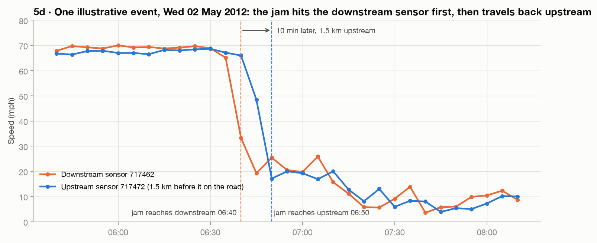
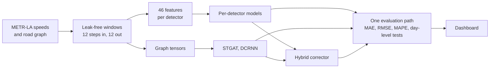
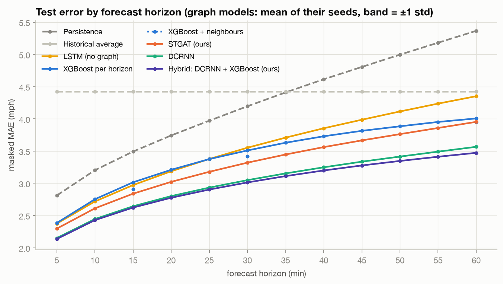
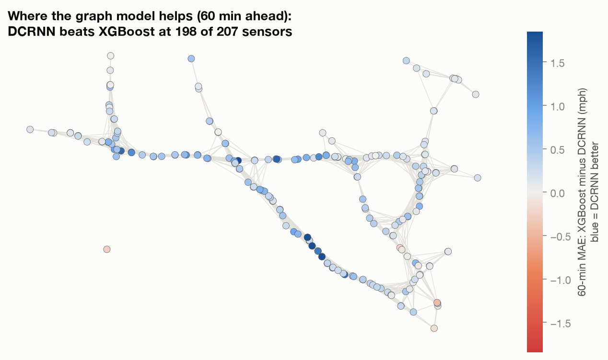

<div align="center">

# MetroFlow

**Spatio-temporal graph neural networks and hybrid forecasting for freeway traffic**

[](https://trafficflowamldl.streamlit.app)


[Live dashboard](https://trafficflowamldl.streamlit.app) ·
[AML report](docs/reports/AML_Report.pdf) ·
[AML slides](docs/slides/AML_Slides.pptx) ·
[DL report](docs/reports/DL_Report.pdf) ·
[DL slides](docs/slides/DL_Slides.pptx)

</div>

MetroFlow forecasts freeway speed 5 to 60 minutes ahead for the 207 loop detectors of METR-LA in Los Angeles. It asks
whether a model that reads the road network forecasts better than strong models that look at one detector at a time, and
where the gain comes from. Every model, from repeating the last reading to graph neural networks, is trained and scored
under one leak-free protocol and compared with day-level significance tests.

| Test error (MAE, mph) | 15 min | 30 min | 60 min |
|---|---:|---:|---:|
| XGBoost, the best per-detector model | 3.02 | 3.51 | 4.01 |
| DCRNN, diffusion graph model | 2.64 | 3.05 | 3.57 |
| **Hybrid: DCRNN + XGBoost corrector (ours)** | **2.62** | **3.01** | **3.47** |
| Hybrid against XGBoost | -13.0% | -14.2% | -13.3% |



*A jam travels against the traffic at about 16 km/h. The downstream detector slows first, so a model that sees only one
detector's history cannot see it coming.*

## Contents

[Highlights](#highlights) ·
[Data](#data) ·
[Method](#method) ·
[Results](#results) ·
[Operational evaluation](#operational-evaluation) ·
[Getting started](#getting-started) ·
[Repository structure](#repository-structure) ·
[Testing and reproducibility](#testing-and-reproducibility) ·
[Limitations](#limitations) ·
[References](#references) ·
[Team](#team)

## Highlights

- **The graph helps, reliably.** DCRNN beats XGBoost by 12.3%, 13.1% and 11.0% at 15, 30 and 60 minutes, on all 24 test
  days (paired day-level bootstrap and Diebold-Mariano tests, p < 0.0001).
- **The hybrid is best by MAE and MAPE** at all three headline horizons, with 16.5% lower weekday-peak error than XGBoost.
- **The real road matters.** Removing the graph, or replacing it with a random one of the same size, removes most of the
  gain. Hearing downstream neighbours matters more than hearing upstream ones.
- **The attention is interpretable.** STGAT, our graph attention network, moves attention downstream (52% to 62%) when a
  slowdown is 30 minutes away, for 149 of 163 detectors.
- **Alerts and ranges are honest.** At about 56 false alarms a day over 207 detectors the hybrid warns of 35% of jams ten minutes
  ahead, and its 80% ranges hold 80% of the time on average, with their failures reported.
- **The implementation is faithful.** Our DCRNN port reproduces the published METR-LA numbers to within 1.5%, and our
  attention layer is tested to equal PyTorch Geometric's `GATv2Conv`.

## Data

METR-LA as distributed with the [DCRNN](https://github.com/liyaguang/DCRNN#data-preparation) code: 34,272 five-minute
readings from 207 detectors, 1 March to 27 June 2012, with a directed road-distance adjacency matrix (1,515 links, mean
degree 7.32). Outages (0 mph, 8.1% of readings) are masked and never treated as traffic.

| Block | Windows | First target | Last target |
|---|---:|---|---|
| Train, 70% | 22,933 | 2012-03-01 01:00 | 2012-05-23 07:05 |
| Validation, 10% | 3,417 | 2012-05-23 07:10 | 2012-06-04 04:45 |
| Test, 20% (last 24 days) | 6,843 | 2012-06-04 04:50 | 2012-06-27 23:55 |

## Method



- **Split by time.** Windows whose targets cross a block boundary are dropped, so no target is in two blocks. The scaler,
  the imputation table and the free-flow speeds use training data only.
- **Equal history.** Every model reads the last 60 minutes and predicts the next 60.
- **Masked everywhere.** Missing readings are ignored by every loss and metric.
- **Validation decides.** Hyper-parameters, stopping and thresholds never see the test block.
- **Days, not rows.** Significance tests resample whole days, because errors within a day move together.

| Model | Idea | Parameters |
|---|---|---:|
| Persistence, historical average, Ridge, Random Forest, LSTM, XGBoost | Per-detector baselines | |
| **STGAT** (ours) | Shared GRU, then two GATv2 layers over both directions of every road link, with edge direction as a feature | 65,420 |
| **DCRNN** (Li et al., 2018) | Diffusion convolution over forward and backward random walks inside a GRU encoder-decoder | 377,153 |
| **Hybrid** (ours) | DCRNN plus one shallow, regularised XGBoost per horizon that learns DCRNN's remaining error, fitted on validation only | DCRNN + 12 small tree models |

## Results

Test block, 24 days. Graph models and the hybrid are means of three seeds.

| Model | MAE 15 | MAE 30 | MAE 60 | RMSE 60 | MAPE 60 | Peak MAE 60 |
|---|---:|---:|---:|---:|---:|---:|
| Persistence | 3.49 | 4.20 | 5.37 | 10.29 | 14.5% | 8.32 |
| Historical average | 4.42 | 4.42 | 4.42 | 8.08 | 13.9% | 6.82 |
| Ridge per detector | 3.31 | 4.08 | 5.17 | 8.67 | 15.5% | 7.93 |
| Random Forest | 3.08 | 3.68 | 4.45 | 7.85 | 13.5% | 7.08 |
| LSTM, no graph | 2.97 | 3.55 | 4.35 | 8.84 | 13.5% | 6.96 |
| XGBoost | 3.02 | 3.51 | 4.01 | 7.28 | 12.0% | 6.22 |
| XGBoost + neighbour speeds | 2.91 | 3.42 | 3.95 | **7.14** | 11.7% | 6.07 |
| STGAT (ours) | 2.84 | 3.32 | 3.95 | 7.96 | 11.9% | 6.07 |
| DCRNN | 2.64 | 3.05 | 3.57 | 7.67 | 10.4% | 5.40 |
| **Hybrid (ours)** | **2.62** | **3.01** | **3.47** | 7.30 | **10.3%** | **5.20** |



| Comparison | Gain at 15 / 30 / 60 min | Days better, of 24 | p-value |
|---|---|---|---|
| DCRNN against XGBoost | 12.3% / 13.1% / 11.0% | 24 at every horizon | < 0.0001 |
| Hybrid against XGBoost | 13.0% / 14.2% / 13.3% | 24 at every horizon | < 0.0001 |
| Hybrid against DCRNN | 0.8% / 1.2% / 2.6% | at least 23 | < 0.0001 |
| STGAT against XGBoost | 5.8% / 5.4% / 1.3% | 24, 24, 16 | 0.021 (bootstrap), 0.061 (DM) at 60 min |

**What per-detector models miss.** In the 30 minutes after a jam starts, XGBoost's error is 5.2 to 6.4 times larger than at
other times, 15 to 60 minutes ahead. The errors of road-linked detectors are correlated (0.20 at 60 minutes for detectors
one link apart) while those of unconnected detectors are not. Adding hand-made neighbour speeds lowers error by up to 3.5%.

**Where the graph's gain comes from** (STGAT, seed 0, change in MAE at 60 minutes):

| Ablation | Change (mph) |
|---|---:|
| No graph | +0.40 |
| Random graph, same number of links | +0.22 |
| One attention layer instead of two | +0.15 |
| Upstream messages only | +0.10 |
| No direction feature | +0.09 |
| Downstream messages only | +0.07 |
| No dropout | -0.03 |

**On the map.** At the busiest weekday evening moment of the test block, chosen by that rule, 103 detectors were congested.
The 30-minute forecasts of XGBoost caught 75 of them and DCRNN 88.


| Where DCRNN helps, 60 minutes ahead | Time and space along one freeway |
|---|---|
|  |  |

## Operational evaluation

What an operator would ask of these forecasts, measured with one retrained seed (seed 0). `make operations` reproduces it.

### Congestion alerts

A jam is three readings in a row below half of a detector's free-flow speed, after 30 clear minutes. The test block holds
2,624 of them over 24 days. Each model's alert threshold is set on validation days for 50 false alarms a day over all 207
detectors. June was busier than the validation days, so the false alarms that followed are slightly higher.

| Alert signal | False alarms a day | Alerts that were right | Jams warned 10+ min ahead | 20+ min ahead |
|---|---:|---:|---:|---:|
| **Hybrid forecast** | 56 | 46% | **35%** (95% interval 31 to 39%) | 25% |
| Hybrid, calibrated probability | 56 | 43% | 27% | 15% |
| DCRNN | 54 | 45% | 34% | 25% |
| XGBoost | 52 | 38% | 20% | 16% |
| Calendar (usual daily pattern) | 42 | 39% | 23% | 20% |
| Trend rule (no model) | 55 | 30% | 8% | 4% |

The hybrid warns about more jams than XGBoost at the same budget, and most jams still go unwarned. The main signal was chosen by
validation recall. The calibrated probability, which we expected to win, is the weaker alert because it fires later.

### Forecast ranges

Conformal ranges, calibrated on out-of-fold validation errors. They hold their promise on average and widen when traffic is
uncertain. They do not hold just after a jam starts, when errors are largest.

| 80% range | 15 min | 30 min | 60 min |
|---|---:|---:|---:|
| Held the true speed | 79.6% | 79.8% | 80.1% |
| One fixed width | 78.2% | 78.3% | 78.4% |
| Interval score, adaptive / fixed (lower is better) | 15.1 / 17.1 | 17.9 / 20.5 | 21.0 / 24.5 |
| Held, in the 30 minutes after a jam starts | 50% | 40% | 38% |

Daily coverage ran from 77% to 86% at each horizon. Stated jam probabilities match observed frequencies closely (see the
dashboard's Ranges page).

### Failure tests

Inputs are broken, nothing is retrained, targets stay real. Mean absolute error 30 minutes ahead:

| Failure | Hybrid | DCRNN | STGAT | XGBoost | Repeat last reading |
|---|---:|---:|---:|---:|---:|
| None | 3.02 | 3.05 | 3.32 | 3.51 | 4.19 |
| 30% of detectors off | 3.43 | 3.46 | 3.85 | 4.05 | 4.57 |
| 30% stuck at free flow | 4.45 | 4.41 | 4.83 | 4.55 | 5.43 |
| Feed 30 minutes late | 3.81 | 3.87 | 4.38 | 5.05 | 5.35 |
| Noise, 10 mph | 4.28 | 4.50 | 6.00 | 5.58 | 9.63 |
| 30% of readings corrupted | 4.89 | 5.02 | 5.61 | 6.98 | 10.98 |

The hybrid degrades most when detectors silently stick: its error rises 48% at 30% stuck, against 30% for XGBoost, and
DCRNN becomes slightly better than the hybrid. For delays, noise and corrupted readings its error rises less than XGBoost's.
Detecting stuck detectors should come before relying on the forecasts.

## Getting started

Run the dashboard, which needs only the committed result files:

```bash
git clone https://github.com/ManasSaxena14/TrafficFlowControl_AIML-DL_T036.git metroflow
cd metroflow
pip install -r requirements.txt
streamlit run app.py
```

Reproduce the pipeline (Python 3.11 or newer, [uv](https://docs.astral.sh/uv/); on macOS also `brew install libomp`):

```bash
make setup         # environment
make data          # METR-LA and the sensor graph
make preprocess features
make baselines gap accuracy
make graph         # about 10 hours on an Apple M3 Pro, resumable
make hybrid ablations compare maps
make operations
make test lint
```

`make help` lists every command. Raw data, intermediate arrays (about 2.5 GB per protocol) and checkpoints are not
committed.

## Repository structure

```
.
├── app.py                Streamlit entry point
├── dashboard/            dashboard pages and theme
├── metroflow/            Python package
│   ├── data/             loading and leak-free preprocessing
│   ├── features/         46-column per-detector feature table
│   ├── models/           baselines, trees, LSTM, graph layers, STGAT, DCRNN, hybrid
│   ├── train/            one runner per model family
│   ├── eval/             metrics, comparison, ablations, alerts, ranges, failure tests
│   ├── analysis/         exploratory and gap analysis
│   └── viz/              figures and maps
├── configs/              split, window, masking and peak definitions
├── notebooks/            exploratory data analysis
├── scripts/              data download and graph-model runs
├── tests/                automated tests
├── results/              every result table (CSV and JSON), grouped by topic
└── docs/
    ├── reports/          AML and DL reports (PDF)
    ├── slides/           AML and DL slide decks
    └── figures/          images used in this README
```

| Document | Contents |
|---|---|
| [AML report](docs/reports/AML_Report.pdf) (22 pages) | Data, leak-free method, six baselines and the gap analysis |
| [AML slides](docs/slides/AML_Slides.pptx) (13 slides) | The machine-learning phase |
| [DL report](docs/reports/DL_Report.pdf) (27 pages) | STGAT, DCRNN, the hybrid, significance tests, ablations, attention and maps |
| [DL slides](docs/slides/DL_Slides.pptx) (17 slides) | The deep-learning phase |

## Testing and reproducibility

- **69 automated tests** cover chronological order, no shared targets between blocks, train-only statistics, masked metrics,
  sensor order, the attention layer against PyTorch Geometric, information flowing only along given edges, the hybrid's
  chronological fitting split, alert timing, range calibration and corrupted inputs. Tests that need METR-LA are skipped
  until `make data` has been run.
- **Seeds.** Graph models and the hybrid use three seeds. The seed standard deviation of test MAE is at most 0.002 mph for
  STGAT and 0.010 mph for DCRNN.
- **Reproduction.** Under the reference protocol our DCRNN reaches 2.63 / 3.03 / 3.54 mph, against the published 2.67 / 3.08 /
  3.56. Independent retraining on another Mac matched the stored scores exactly for XGBoost, to three decimals for DCRNN (seed 0)
  and within 0.004 mph for STGAT (seed 0).

## Limitations

- METR-LA records speed only. The data are 2012 freeway readings from one city, and transfer is untested.
- Baselines use one seed (42) and ablations use one. Graph models and the hybrid use three. The operational evaluation uses one
  retrained seed, and the reports predate it.
- The hybrid is fitted on the validation block, which the baselines used only for tuning.
- Several boosted models stopped at their round limit rather than by early stopping: XGBoost (600 rounds) at every horizon
  from 20 minutes on, and the hybrid's corrector (1,500 rounds) in 35 of 36 fits. Longer training might lower both errors.
- Signal control was not run. METR-LA freeways have no signals, and nothing here controls real traffic.

## References

The full bibliography is in the reports.

1. Li, Yu, Shahabi, Liu. *Diffusion Convolutional Recurrent Neural Network: Data-Driven Traffic Forecasting.* ICLR 2018. [arXiv:1707.01926](https://arxiv.org/abs/1707.01926)
2. Veličković et al. *Graph Attention Networks.* ICLR 2018. [arXiv:1710.10903](https://arxiv.org/abs/1710.10903)
3. Brody, Alon, Yahav. *How Attentive are Graph Attention Networks?* ICLR 2022. [arXiv:2105.14491](https://arxiv.org/abs/2105.14491)
4. Yu, Yin, Zhu. *Spatio-Temporal Graph Convolutional Networks.* IJCAI 2018. [arXiv:1709.04875](https://arxiv.org/abs/1709.04875)
5. Wu et al. *Graph WaveNet for Deep Spatial-Temporal Graph Modeling.* IJCAI 2019. [arXiv:1906.00121](https://arxiv.org/abs/1906.00121)
6. Chen, Guestrin. *XGBoost: A Scalable Tree Boosting System.* KDD 2016. [doi:10.1145/2939672.2939785](https://doi.org/10.1145/2939672.2939785)
7. Diebold, Mariano. *Comparing Predictive Accuracy.* Journal of Business & Economic Statistics, 1995.
8. Harvey, Leybourne, Newbold. *Testing the Equality of Prediction Mean Squared Errors.* International Journal of Forecasting, 1997.
9. Jagadish et al. *Big Data and Its Technical Challenges.* Communications of the ACM, 2014. [doi:10.1145/2611567](https://doi.org/10.1145/2611567)

## Team

Team T036, Newton School of Technology, Rishihood University.

| Member | Machine-learning phase | Deep-learning phase |
|---|---|---|
| Harsh Raj (2401010180) | Project setup, data loading, exploratory analysis, congestion-propagation finding | STGAT graph attention model, graph layers, attention inspection |
| Manas Saxena (2401010260) | Leak-free preprocessing, feature engineering, six baselines, XGBoost and Random Forest tuning, gap analysis, AML report and slides | DCRNN and ablation studies, fair comparison and significance tests, hybrid model, published-number reproduction, DL report |
| Sumit Yadav (2401010464) | Streamlit dashboard, accuracy metrics | Congestion maps, time-space diagram, DL slides |
